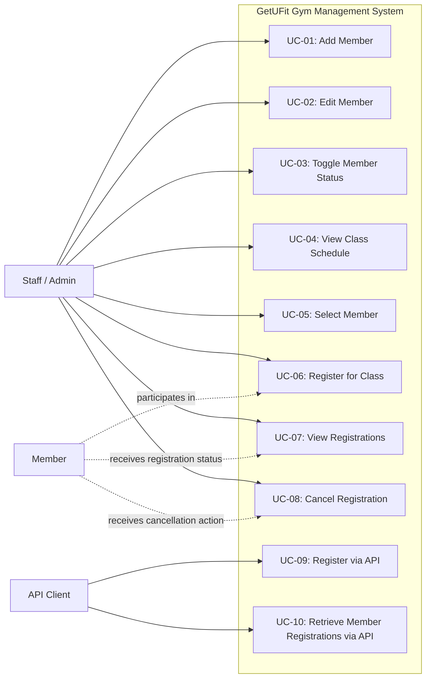

# GetUFit Documentation

## 1. Project Overview

GetUFit is a gym management system built with Spring Boot. It helps staff manage members and class registrations, and allows a selected member to register for upcoming fitness classes.

## 2. Use Cases

The following use cases describe the main functions of the system.

### UC-01: Add a new member
- Actor: Staff/Admin
- Goal: Add a new member to the gym system.
- Preconditions: Staff is on the member management page.
- Main flow:
  1. Staff clicks "Add member".
  2. Staff enters full name, DOB, gender, address, phone, email, and password.
  3. System validates the form.
  4. System encrypts the password and saves the member.
  5. System sets the member status to Active and join date to today.
  6. Member is displayed in the member list.
- Alternative flow:
  - If email already exists or password is too short, the system shows validation errors.

### UC-02: Edit member information
- Actor: Staff/Admin
- Goal: Update the details of an existing member.
- Preconditions: Member exists in the database.
- Main flow:
  1. Staff opens the edit form for a member.
  2. Staff updates personal information.
  3. System validates the updated values.
  4. System saves the changes.
  5. Staff receives confirmation that the member was updated.

### UC-03: Activate or deactivate a member
- Actor: Staff/Admin
- Goal: Change a member's status.
- Preconditions: Member exists.
- Main flow:
  1. Staff selects a member from the member list.
  2. Staff clicks the Activate/Deactivate button.
  3. System toggles status between Active and Inactive.
  4. The member list reflects the new status.

### UC-04: View class schedule
- Actor: Staff/Admin
- Goal: Review all upcoming classes.
- Preconditions: At least one class exists in the system.
- Main flow:
  1. Staff opens the class schedule page.
  2. System displays upcoming classes sorted by date and time.
  3. System shows each class’s name, date, time, type, and available seats.

### UC-05: Select a member before registration
- Actor: Staff/Admin
- Goal: Choose which member will be registered for a class.
- Preconditions: Member list is available.
- Main flow:
  1. Staff selects a member from the dropdown on the class page.
  2. System keeps the selected member ID in the current session request.
  3. Staff can then register the selected member for a class.

### UC-06: Register a member for a class
- Actor: Staff/Admin
- Goal: Register an active member for a gym class.
- Preconditions:
  - Member is selected.
  - Member status is Active.
  - Class exists and has seat availability.
- Main flow:
  1. Staff clicks the Register button for a class.
  2. System validates that the member is active.
  3. System checks whether the member is already registered for that class.
  4. System verifies class capacity is not exceeded.
  5. System creates a ClassRegistration record with status Registered.
  6. Success message is displayed.
- Alternative flow:
  - If the member is inactive, duplicate registration exists, or the class is full, the system shows an error message.

### UC-07: View a member’s registrations
- Actor: Staff/Admin
- Goal: See the classes that a specific member has registered for.
- Preconditions: Member exists and has one or more registrations.
- Main flow:
  1. Staff opens the member registration view.
  2. System loads all registrations for that member.
  3. System displays registration date, class details, and status.

### UC-08: Cancel a registration
- Actor: Staff/Admin
- Goal: Cancel a member's class registration.
- Preconditions: Registration exists.
- Main flow:
  1. Staff selects a registration from the member’s registration list.
  2. Staff clicks Cancel.
  3. System updates the registration status to Cancelled.
  4. The cancellation is reflected in the registration list.

### UC-09: Register via REST API
- Actor: External system / API client
- Goal: Submit a class registration through an API request.
- Preconditions: API client has a valid member ID and class ID.
- Main flow:
  1. Client sends POST request to `/api/registrations` with memberId and classId.
  2. Server validates the request.
  3. Server creates a registration or returns an error if rules are violated.
  4. Server returns the created registration object.

### UC-10: Retrieve registrations for a member via API
- Actor: External system / API client
- Goal: View all registrations for a member.
- Main flow:
  1. Client sends GET request to `/api/registrations/member/{memberId}`.
  2. Server queries registration records for that member.
  3. Server returns matching registration details.

## 3. Actors

- Staff/Admin: manages members, classes, and registrations.
- Member: is selected for class registration.
- API client: interacts with registration endpoints programmatically.

## 4. Business Rules Derived from Use Cases

- A member must be Active before being registered for a class.
- A member cannot register for the same class twice.
- A class cannot exceed its capacity.
- Registration status can be Registered or Cancelled.
- Only valid members and valid class IDs can be used for registration.

## 5. Formal UML Use Case Diagram

## 6. Summary

The system’s main use cases focus on managing gym membership records and class enrollment. The primary value of the application is to keep the schedule organized, enforce capacity rules, and provide a simple view of member registrations.
