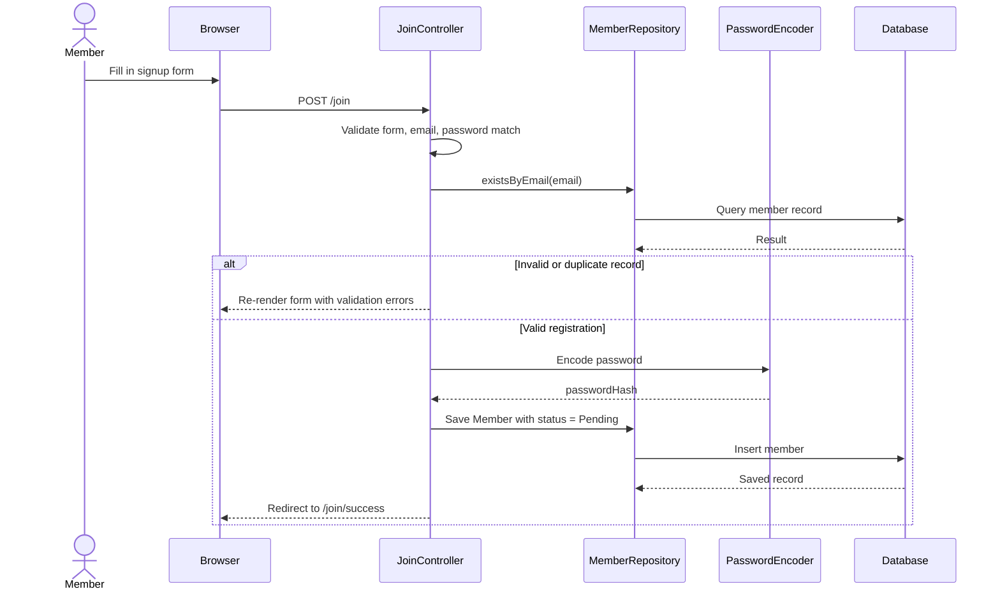
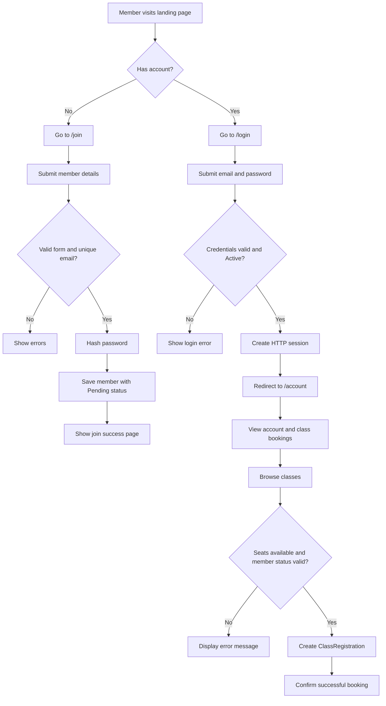

# GetUFit


GetUFit is a Spring MVC fitness club application for managing member onboarding, trainer administration, and class registrations. It helps members sign up, log in, browse available classes, register for sessions, and track bookings, while staff and trainers manage schedules, class capacity, and class attendance.

## Key Features

- Member sign-up and approval workflow with validation and password hashing
- Session-based login and logout for members and trainers
- Class catalog with live seat availability and trainer names
- Booking and cancellation logic with capacity and duplicate registration checks
- Staff scheduling module for creating, editing, and deleting classes
- Trainer dashboard to view scheduled classes and registered members
- Spring MVC + Thymeleaf server-rendered UI for simple, fast deployment

## Tech Stack & Tools

- Java 21
- Spring Boot 4.0.8
- Spring Web MVC
- Spring Data JPA
- Spring Validation
- Thymeleaf template engine
- MySQL database
- Maven build tool
- Lombok for boilerplate reduction
- BCrypt-based password hashing via Spring Security Crypto

Official references:

- [Spring Boot](https://spring.io/projects/spring-boot)
- [Spring Data JPA](https://spring.io/projects/spring-data-jpa)
- [Thymeleaf](https://www.thymeleaf.org/)
- [Java 21](https://docs.oracle.com/en/java/javase/21/)
- [MySQL](https://dev.mysql.com/doc/)
- [Maven](https://maven.apache.org/)

## Project Architecture

```text
getufit/
├── docs/
│   └── sequence-diagrams.md        # Workflow diagrams and sequence examples
├── src/
│   ├── main/
│   │   ├── java/com/getufit/
│   │   │   ├── config/
│   │   │   │   ├── AppConfig.java
│   │   │   │   ├── AuthInterceptor.java
│   │   │   │   ├── TrainerAuthInterceptor.java
│   │   │   │   └── WebConfig.java
│   │   │   ├── controller/
│   │   │   │   ├── AccountController.java
│   │   │   │   ├── AuthController.java
│   │   │   │   ├── JoinController.java
│   │   │   │   ├── LandingController.java
│   │   │   │   ├── MemberPageController.java
│   │   │   │   ├── PageController.java
│   │   │   │   ├── RegistrationController.java
│   │   │   │   ├── ScheduleController.java
│   │   │   │   ├── TrainerAuthController.java
│   │   │   │   ├── TrainerClassController.java
│   │   │   │   ├── TrainerPageController.java
│   │   │   │   └── TrainerPortalController.java
│   │   │   ├── dto/
│   │   │   │   └── JoinForm.java
│   │   │   ├── model/
│   │   │   │   ├── ClassRegistration.java
│   │   │   │   ├── GymClass.java
│   │   │   │   ├── Member.java
│   │   │   │   ├── Trainer.java
│   │   │   │   └── TrainerAccount.java
│   │   │   ├── repository/
│   │   │   │   ├── ClassRegistrationRepository.java
│   │   │   │   ├── GymClassRepository.java
│   │   │   │   ├── MemberRepository.java
│   │   │   │   ├── TrainerAccountRepository.java
│   │   │   │   └── TrainerRepository.java
│   │   │   ├── service/
│   │   │   │   └── RegistrationService.java
│   │   │   └── GetufitApplication.java
│   │   └── resources/
│   │       ├── application.properties
│   │       └── templates/
│   │           ├── account.html
│   │           ├── account-classes.html
│   │           ├── classes.html
│   │           ├── index.html
│   │           ├── join.html
│   │           ├── join-success.html
│   │           ├── landing.html
│   │           ├── login.html
│   │           ├── members.html
│   │           ├── registrations.html
│   │           ├── schedule.html
│   │           ├── schedule-form.html
│   │           ├── trainer-dashboard.html
│   │           ├── trainer-login.html
│   │           ├── trainer-form.html
│   │           ├── trainer-class-members.html
│   │           ├── trainers.html
│   │           └── ...
│   └── test/
│       └── java/com/getufit/GetufitApplicationTests.java
├── pom.xml
├── mvnw / mvnw.cmd
├── .gitignore
├── README.md
└── target/                       # compiled artifacts and generated classes
```

## Java Concepts Used

This project makes regular use of core Spring and Java patterns:

- `@SpringBootApplication` bootstraps the app and starts the application context
- `@Controller` and `@RequestMapping` define MVC endpoints for pages like `/login`, `/account`, `/schedule`, and `/trainer`
- `@Service` encapsulates business rules in `RegistrationService`
- `@Entity` models map to database tables such as `Member`, `Trainer`, `GymClass`, and `ClassRegistration`
- `@Id`, `@GeneratedValue`, and `@ManyToOne` handle database identity and relationships
- `JpaRepository` interfaces provide persistence methods such as `findByEmail`, `existsByEmail`, and `countByGymClass_ClassIDAndStatus`
- `@Valid` and `BindingResult` enforce form validation on signup, schedule creation, and trainer management
- `PasswordEncoder` hashes passwords before storing them
- HTTP sessions keep state using variables such as `memberId` and `trainerId`
- `RedirectAttributes` is used for success and error flash messages after form submissions

### Key Variable Names Highlighted

Across the codebase, the application consistently uses names such as:

- `memberId` — current member identifier in session and booking flows
- `classId` — selected gym class identifier
- `registrationId` — specific class booking record
- `currentMember` — request attribute set by `AuthInterceptor`
- `currentTrainer` — request attribute set by `TrainerAuthInterceptor`
- `gymClass` — domain object used in scheduling and validation
- `trainerID` and `trainerId` — trainer references in the model and session
- `passwordHash` — securely stored hashed password field

## Frontend Implementation

The UI is implemented as a server-rendered Spring MVC + Thymeleaf application rather than a separate frontend framework. The HTML files in `src/main/resources/templates/` contain the page structure, inline CSS, and Thymeleaf attributes such as:

- `th:action` and `th:href` for routing
- `th:field` for form binding
- `th:if` and `th:each` for conditional rendering and list iteration
- `th:text` to display data directly from model attributes

Example:

```html
<form method="post" th:action="@{/login}">
    <input id="email" name="email" type="email" th:value="${email}" required>
</form>
```

This keeps the project lightweight and easy to deploy while still supporting a polished, branded landing page and management screens.

## Sequence Diagram



## Activity Diagram



## Getting Started

### Prerequisites

- Java 21 or newer
- Maven 3.9+
- MySQL server running locally or in a dev environment
- A database named `GetUFitDB`

### Local Setup

1. Clone the repository:

```bash
git clone https://github.com/Thiviyan23/getufit.git
cd getufit
```

2. Create the database in MySQL:

```sql
CREATE DATABASE GetUFitDB;
```

3. Update database credentials in `src/main/resources/application.properties` if needed:

```properties
spring.datasource.url=jdbc:mysql://localhost:3306/GetUFitDB
spring.datasource.username=root
spring.datasource.password=
server.port=8081
```

There is no `.env.example` file in this repository; configuration is currently managed directly through `application.properties`.

4. Build and run the app:

```bash
./mvnw clean install
./mvnw spring-boot:run
```

The application will be available at:

- `http://localhost:8081/landing`
- `http://localhost:8081/login`
- `http://localhost:8081/trainers`

## Usage Examples

### Run the application

```bash
./mvnw spring-boot:run
```

### Run the tests

```bash
./mvnw test
```

### Access the public landing page

```bash
curl http://localhost:8081/landing
```

### Typical member workflow

1. Open `/join` and create a member account
2. Wait for staff activation or verify the account is active
3. Sign in at `/login`
4. Open `/account/classes` to browse classes
5. Book a session and review bookings at `/account`

## Testing

The project includes a basic Spring Boot smoke test:

```java
@SpringBootTest
class GetufitApplicationTests {
    @Test
    void contextLoads() {
    }
}
```

Run the full suite with:

```bash
./mvnw test
```

## Contributing Guidelines

Contributions are welcome. Please follow these steps:

1. Fork the repository and create a feature branch
2. Keep changes focused and aligned with the existing MVC + JPA structure
3. Add or update tests when changing business logic
4. Ensure the application still compiles with Maven
5. Open a pull request with a clear summary of the change

## License

This project does not currently include a `LICENSE` file, so no explicit license is declared for redistribution or reuse. If this repo is intended for public distribution, add a license before publishing or sharing externally.

## Notes

- The project uses server-side rendering and does not currently include a separate frontend build pipeline.
- Session management is implemented with standard servlet sessions rather than JWT.
- Class scheduling validates against trainer conflicts and seat capacity before saving bookings.
