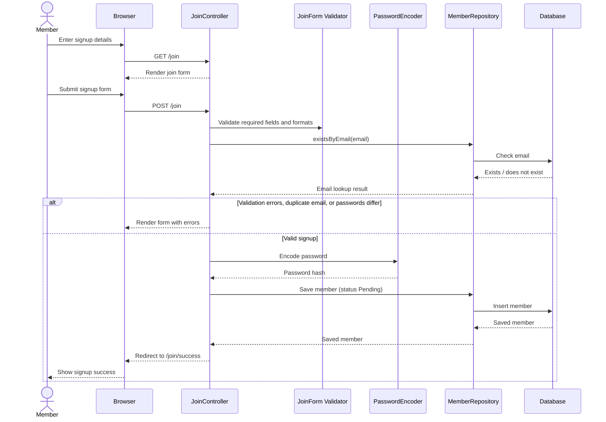
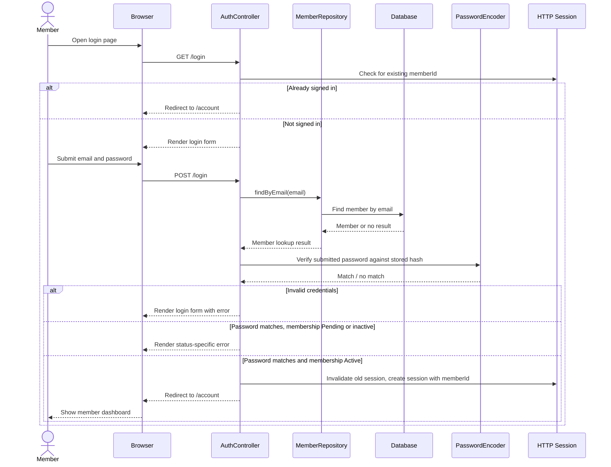
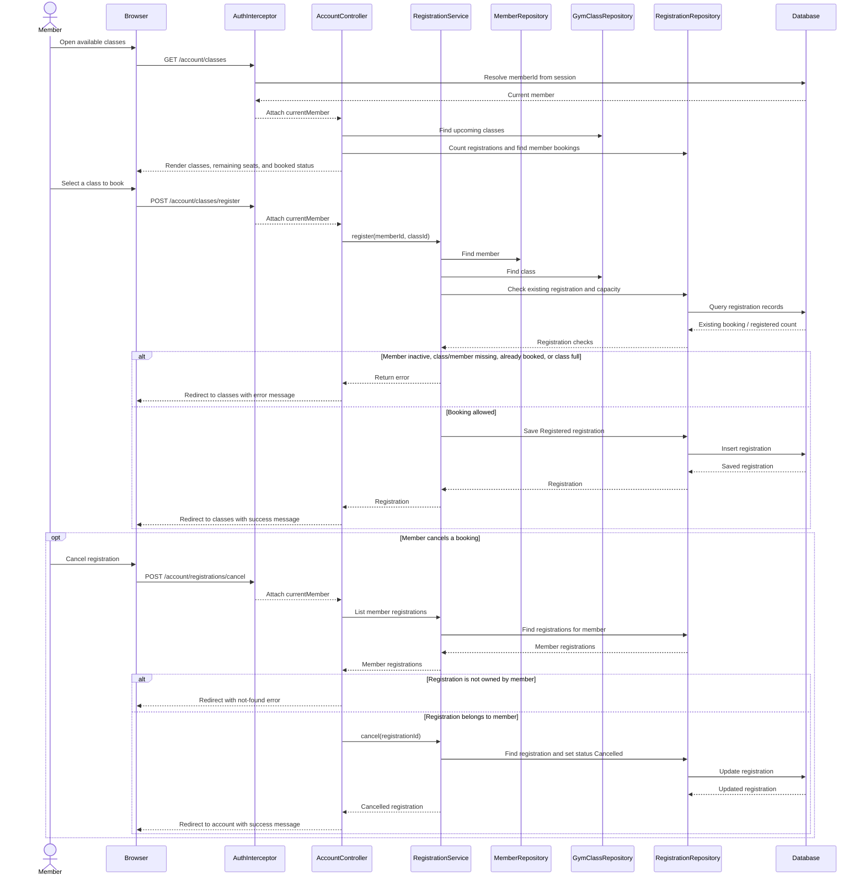
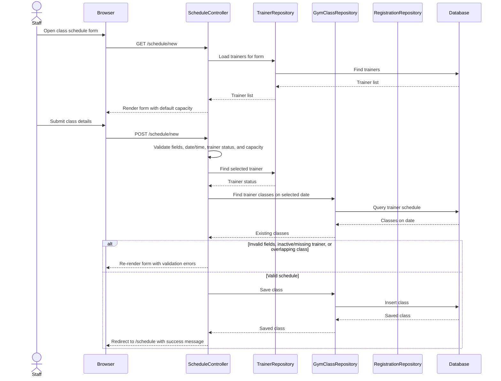

# GetUFit Sequence Diagrams

These diagrams describe the primary application workflows implemented by the Spring MVC controllers and services.

## 1. Member Signup

## 2. Member Login

## 3. Class Booking and Cancellation

## 4. Staff Class Scheduling

